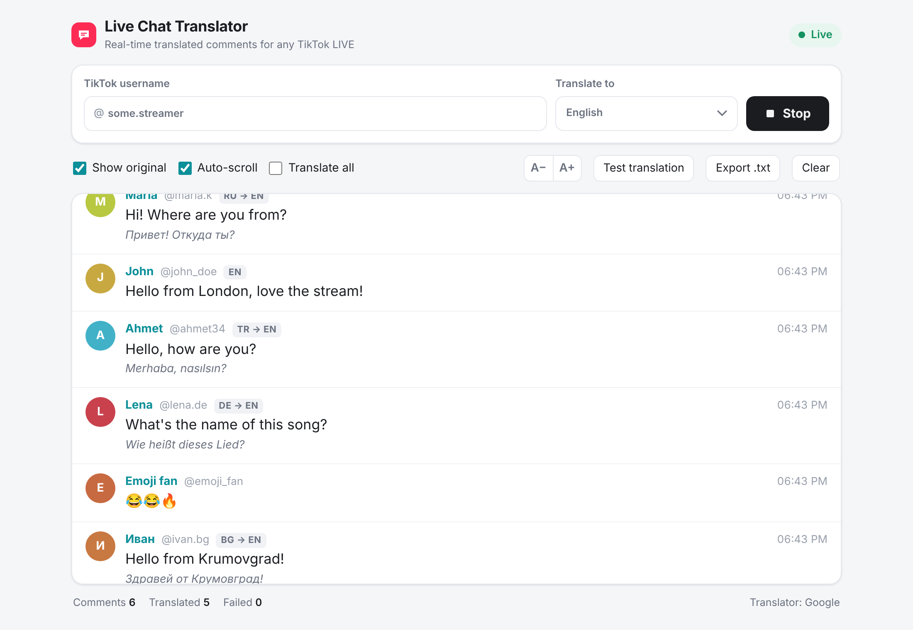

# Live Chat Translator for TikTok LIVE

Real-time translated comments for any public **TikTok LIVE**. Type the @username, pick a language, press **Start**, and every chat comment appears translated in your browser.

- Works with any LIVE, however it's streamed (phone, TikTok LIVE Studio, OBS).
- Free: no accounts, no API keys.
- Runs on your own computer (Mac or Windows) and opens in the browser.
- Nothing is posted to the LIVE chat. The translations are only shown on your screen.



**[Инструкции на български ↓](#инструкции-на-български)**

---

## Mac app (easiest — nothing to install)

1. Download **[Live-Chat-Translator-mac.zip](https://github.com/waitingboy-collab/tiktok-chat-translator/releases/latest/download/Live-Chat-Translator-mac.zip)** (from [Releases](https://github.com/waitingboy-collab/tiktok-chat-translator/releases)).
2. Double-click the ZIP. You get **Live Chat Translator.app**. Drag it to **Applications**.
3. Double-click **Live Chat Translator**. The first time macOS blocks it because the app isn't from the App Store:
   - Click **Done** (or **OK**), open **System Settings → Privacy & Security**, scroll down and click **Open Anyway** next to "Live Chat Translator", then confirm with your password.
   - On older macOS: right-click the app → **Open** → **Open**.
4. The translator opens in its own window (Chrome/Edge if installed, otherwise Safari).

Works on Apple Silicon (M1–M4) and Intel Macs, macOS 11 or newer. Node.js is built in.
Close the window and the app stops by itself after ~30 seconds, or press **Quit** in the top-right corner.
If something goes wrong, the log is in `~/Library/Logs/LiveChatTranslator.log`.

---

## Install on a Mac (with Node.js)

Use this if you prefer to run it from the source code.

### 1. Install Node.js (once)

1. Go to **https://nodejs.org** and download the **LTS** version (the big green button, "macOS Installer").
2. Open the downloaded `.pkg` file and click **Continue → Install** until it finishes.

### 2. Download the translator

1. On this page click the green **Code** button → **Download ZIP**.
2. Open the ZIP in **Downloads**. You get the folder `tiktok-chat-translator-main`. You can move it anywhere, e.g. to Documents.

### 3. Start it

1. Open the folder and **double-click `start.command`**.
2. The first time, macOS says it "can't be opened because it is from an unidentified developer". Close that message, then **right-click (or Control-click) `start.command` → Open → Open**. You only need to do this once.
   - On newer macOS versions, go to **System Settings → Privacy & Security**, scroll down, and click **Open Anyway** next to `start.command`.
3. A Terminal window opens. The first run installs what it needs (about a minute, needs internet).
4. The translator opens in your browser at **http://localhost:3030**.

**Keep the Terminal window open while you use the translator.** Close it to stop.

> **If double-clicking does nothing / "permission denied":** open **Terminal** (Spotlight → "Terminal") and run:
> ```bash
> cd ~/Downloads/tiktok-chat-translator-main
> chmod +x start.command
> ./start.command
> ```
> (Change the path if you moved the folder.)

### 4. Use it

1. Enter the TikTok **username** of the person who is live (or paste the LIVE link).
2. Choose the language under **Translate to**.
3. Press **Start**.

If the person isn't live yet, the page waits and connects by itself when the LIVE starts.

---

## Install on Windows

1. Install **Node.js LTS** from https://nodejs.org.
2. **Code → Download ZIP**, then unzip it.
3. Double-click **`start.bat`**. The page opens at http://localhost:3030.

## Any system (Terminal)

```bash
git clone https://github.com/waitingboy-collab/tiktok-chat-translator.git
cd tiktok-chat-translator
npm install
npm start
```

---

## Features

- **Translate to** can be changed any time. The last 30 comments are re-translated.
- Comments already in your language are shown as they are. Tick **Translate all** to translate everything.
- **Show original**: shows the original text under each translation.
- **A− / A+**: change the text size.
- **Test translation**: checks the translator without a LIVE and shows which service answered.
- **Export .txt**: saves the chat with the translations.
- `http://localhost:3030/?user=NAME` starts straight away for that user.

## Open it on your phone or iPad

1. Open the file **`.env`** in the folder (it appears after the first start) with TextEdit.
2. Change `HOST=127.0.0.1` to `HOST=0.0.0.0` and save.
3. Start `start.command` again. The Terminal shows a line like
   `On your phone (same Wi-Fi) open: http://192.168.1.20:3030`.
   Open that address on the phone. It must be on the same Wi-Fi.

> Files starting with a dot are hidden on a Mac. In Finder press **Cmd + Shift + .** to show them.

## Troubleshooting

| What you see | What to do |
|---|---|
| *"… is not live right now"* | Check the username. The page connects by itself when the LIVE starts. |
| *"This LIVE is restricted (18+ or private)"* | These LIVEs can't be read. |
| *"rate limit"* | The free connection service is busy. Wait a minute; it retries by itself. |
| *"The local server is not running"* | The Terminal window was closed. Start `start.command` again. |
| *"Port 3030 is already in use"* | The translator is already running in another Terminal window. Use that one, or change `PORT` in `.env`. |
| Comments appear but aren't translated | Press **Test translation** and read the message. |

## Build the Mac app yourself

```bash
bash mac/build-mac-app.sh
```

This creates `dist/Live Chat Translator.app` and `dist/Live-Chat-Translator-mac.zip` (works on macOS or Linux, needs Node.js + npm). The app bundles the official signed Node.js binaries for Apple Silicon and Intel.

## How it works

- `server.js` connects to the LIVE chat with [tiktok-live-connector](https://github.com/zerodytrash/TikTok-Live-Connector) and streams the comments to the page. One connection per username is shared by all open pages.
- Translation uses Google's free web endpoints (three addresses), with MyMemory as a fallback. Results are cached.
- To test without a LIVE: `npm run mock` (fake chat in several languages).

---

## Инструкции на български

Превежда в реално време коментарите от всеки публичен **TikTok LIVE**. Пишеш @потребителя, избираш език, натискаш **Start** и всеки коментар се показва преведен в браузъра. Нищо не се пише в чата на лайва, преводите се виждат само на твоя екран.

### Приложение за Mac (най-лесно — нищо не се инсталира)

1. Изтегли **[Live-Chat-Translator-mac.zip](https://github.com/waitingboy-collab/tiktok-chat-translator/releases/latest/download/Live-Chat-Translator-mac.zip)** (от [Releases](https://github.com/waitingboy-collab/tiktok-chat-translator/releases)).
2. Кликни два пъти на ZIP файла. Получаваш **Live Chat Translator.app**. Плъзни го в **Applications**.
3. Кликни два пъти на **Live Chat Translator**. Първия път macOS го спира, защото не е от App Store:
   - Натисни **Done** (или **OK**), отвори **System Settings → Privacy & Security**, слез надолу и натисни **Open Anyway** до „Live Chat Translator“. Потвърди с паролата си.
   - На по-стари macOS: десен бутон върху приложението → **Open** → **Open**.
4. Преводачът се отваря в собствен прозорец (в Chrome/Edge, ако са инсталирани, иначе в Safari).

Работи на Apple Silicon (M1–M4) и Intel Mac, macOS 11 или по-нов. Node.js е вграден.
Затвориш ли прозореца, приложението спира само след около 30 секунди. Може и с бутона **Quit** горе вдясно.

### Инсталиране на Mac (с Node.js)

**1. Инсталирай Node.js (само веднъж)**
1. Отвори **https://nodejs.org** и изтегли версията **LTS** (голямото зелено копче, „macOS Installer“).
2. Отвори изтегления `.pkg` файл и натискай **Continue → Install**, докато приключи.

**2. Изтегли програмата**
1. Горе на тази страница натисни зеленото копче **Code** → **Download ZIP**.
2. Отвори ZIP файла в **Downloads**. Получаваш папка `tiktok-chat-translator-main`. Можеш да я преместиш където искаш.

**3. Пусни я**
1. Отвори папката и кликни два пъти на **`start.command`**.
2. Първия път macOS казва, че файлът е „от неизвестен разработчик“. Затвори съобщението, после **десен бутон (или Control + клик) върху `start.command` → Open → Open**. Това се прави само веднъж.
   - На по-новите macOS: **System Settings → Privacy & Security**, слез надолу и натисни **Open Anyway** до `start.command`.
3. Отваря се прозорец на Terminal. Първия път си изтегля нужното (около минута, иска интернет).
4. Преводачът се отваря в браузъра на **http://localhost:3030**.

**Не затваряй прозореца на Terminal, докато ползваш преводача.** Затвориш ли го, преводачът спира.

> **Ако двойният клик не прави нищо или пише „permission denied“:** отвори **Terminal** (Spotlight → „Terminal“) и напиши:
> ```bash
> cd ~/Downloads/tiktok-chat-translator-main
> chmod +x start.command
> ./start.command
> ```

**4. Ползване**
1. Напиши TikTok **потребителското име** на човека, който е на живо, или постави линка към лайва.
2. Избери език в **Translate to** (например Bulgarian).
3. Натисни **Start**.

Ако човекът още не е на живо, страницата чака и се свързва сама, когато лайвът започне.

**На телефон или iPad (в същата Wi-Fi мрежа):** отвори файла `.env` в папката с TextEdit. Файловете с точка отпред са скрити, във Finder ги показваш с **Cmd + Shift + .**. Смени `HOST=127.0.0.1` на `HOST=0.0.0.0`, запази и пусни отново `start.command`. В Terminal ще пише адреса за телефона.

**Ако нещо не работи:** виж таблицата **Troubleshooting** по-горе. Ако коментарите излизат, но не се превеждат, натисни **Test translation** и прочети съобщението.
